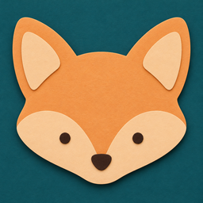
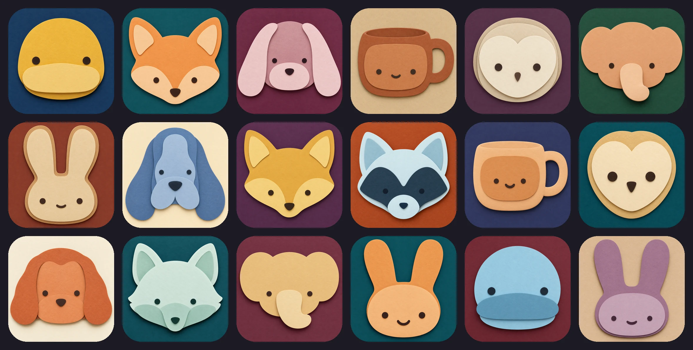

<p align="center"></p>

<h1 align="center">Cutpals</h1>
<p align="center"><strong>让你的 AI 用彩纸给产品剪一个吉祥物。</strong></p>
<p align="center">一份 Agent Skill，Codex、Claude Code 或任何能调用图像模型的 agent 都能用。说说你的产品，拿到六张剪纸吉祥物候选。</p>

<p align="center">
  <a href="LICENSE"></a>
  
  
  
</p>

<p align="center">
  <a href="README.md">English</a> ·
  <a href="https://longado.github.io/cutpals-skill/">图库网站</a> ·
  <a href="#快速开始">快速开始</a> ·
  <a href="#一起做">一起做</a>
</p>

直接找图像模型要吉祥物，出来的多半是平涂剪贴画，或者亮晶晶的 3D 玩具。Cutpals 让它用三四张彩纸叠出来：一个简单的大脑袋，两个点点眼睛，纸层之间有柔和的投影。

**只有一个 Markdown 文件 · 哪个 agent 都能用 · 不用跑任何程序**

## 是什么

`cutpals` 是一份开放 Agent Skills 格式的 `SKILL.md`。它告诉你的 agent 怎么读懂你的产品、挑三个合适的角色，再写出六段图像提示词，让每张图都保持同一种剪纸画风：脑袋居中，3–4 层纸，一个一眼认出物种的特征，四种颜色，一块浓郁的纯色背景纸。

读产品、写提示词由你的 agent 来做，画图由它能调用的图像模型来做。除了这个 Markdown 文件，什么都不用装。

> **早期版本。** 目前只在 Codex CLI 和它内置的出图工具上跑过：七个产品描述，五轮改规则，共 60 张图。Claude Code、Gemini 图像模型和其他 agent 还没试过。详见[已知问题](#已知问题)。



<sub>可以在<a href="https://longado.github.io/cutpals-skill/">图库网站</a>浏览和下载。调规则期间为六个产品描述生成了 48 张，这里挑了 18 张，没有修图。</sub>

## 它怎么做

| 你…… | 它会…… |
|---|---|
| 要一个吉祥物，没指定动物 | 读你的 README 或官网文案，提出三个角色，每个对应产品的一个不同特点 |
| 说可以 | 生成六张：每个角色两套配色，多数用深色背景，其余用浅色本色纸 |
| 自己指定了角色 | 保留它，改为提出这个角色的三种做法 |
| 给了品牌色 | 用在背景纸上 |

每张图都守这些规矩：

- 只画脑袋，正面、居中，占画面约 75%。
- 3–4 层纸，剪刀剪出的干净边缘，层间有柔和投影；不描边，不反光。
- 恰好一个能单独认出物种的特征（长耳朵、象鼻、扁嘴）。如果看着像猫或熊，就是特征选错了。
- 四种颜色：背景纸、主色纸、给某一层用的第二种纸、眼睛和鼻子用的深色纸。
- 缩成 32 × 32 的黑色剪影也认得出来。
- 从不对图像模型说 "logo" 或 "icon"，这些词会把结果带向徽章和文字。
- 六张原样交给你，不筛选，不重画。

## 可以试试这些

下面每一句在我们的测试里都出了六张图（完整文字在 [`examples/briefs`](examples/briefs)）：

| 对你的 agent 说 | 出来了什么 |
|---|---|
| "Make a mascot for my product. Steamcup is a small free macOS menu-bar app (its menu-bar mark is a little coffee cup) that keeps the Mac awake…" | 猫头鹰、大象、一个长着脸的咖啡杯 |
| "Make a mascot for my product: a weather app for people who commute by bike…" | 兔子、鸭子、垂耳狗 |
| "…an open-source command-line tool that replays a failed CI job on your own laptop…" | 狐狸、大象、寻血猎犬 |
| "Make a mascot for my business: a small neighborhood sourdough bakery…" | 小公鸡、小狗、兔子 |
| "…a small open-source notes app that keeps every note as a plain Markdown file…" | 仓鸮、大象、刺猬 |
| "…a small open-source app that copies every new photo from your phone to a drive in your own home each night…" | 猫头鹰、河狸、刺猬 |

## 快速开始

### 方式 A：让你的 AI 帮你装

把这段贴进 Claude Code、Codex 或别的编程 agent：

```text
帮我安装 Cutpals skill：https://github.com/Longado/cutpals-skill
1. 先读它的 README.md 和 SKILL.md。
2. 运行：npx skills@latest add Longado/cutpals-skill --global
   （安装程序问装给哪个 agent 时，选你自己）。
3. 查一下你能调用哪个图像模型。优先 GPT Image 2；Gemini 图像模型
   （Nano Banana Pro、Nano Banana 2）也可以。都没有的话，告诉我需要开通什么。
4. 然后问我要给什么产品做吉祥物。
```

### 方式 B：自己装

```bash
npx skills@latest add Longado/cutpals-skill            # 装到当前项目
npx skills@latest add Longado/cutpals-skill --global   # 所有项目都能用
```

也可以手动把 `SKILL.md` 复制进 agent 的 skills 目录，比如 `~/.claude/skills/cutpals/SKILL.md`。

装好后直接说：*"帮我的产品做个吉祥物。"*

## 已知问题

- **有的动物要单独写规则。** `SKILL.md` 加刺猬那一条之前，6 张刺猬没一张像（像狮子、向日葵或小熊）；要求在刺前面画一根长鼻子之后，一轮 8 张全像了。别的动物可能也需要这样补。
- **老是那几种动物。** 前 8 次运行里，兔子、大象、狗各出现了 4 次。现在规则限定这几种常见动物一批最多用一种；之后只跑了一次不指定动物的，选的是猫头鹰、河狸、刺猬。只有一次，证据还少。
- **"脑袋变深色"已修正，但样本不大。** 前三轮的提示词写的是 "the face is cut from dark paper"，图像模型有时会把整个脑袋涂成深色（第三轮的小公鸡和两只大象）。第四、五轮换成现在的写法后，24 个脑袋全是浅色或中间色。
- **只试过一个 agent、一个出图工具。** 目前所有图都来自 Codex CLI 内置的出图工具（输出 1254 × 1254）。其他 agent 和模型还没测。

## 一起做

**吉祥物能简单到什么程度，还看得出是手工做的？**

| 如果你…… | 可以…… |
|---|---|
| 在用 Gemini 或别的图像模型 | 跑一遍 `examples/briefs` 里的产品描述，把结果发上来 |
| 遇到总画不好的动物 | 在 `SKILL.md` 里补一条更好的"特征"写法 |
| 会做纸艺 | 告诉我们真实的叠纸有哪些地方规则还没写到 |
| 想要别的画风 | fork 一份：画风基本都写在设计规则和提示词模板里 |

欢迎提 issue 或 pull request。

## 致谢

工作流程（三个方向、六张候选、从不对图像模型说 "logo"、32 × 32 测试）改编自 [s1dashu/ip-as-logo-skill](https://github.com/s1dashu/ip-as-logo-skill)（MIT）。Cutpals 把它从角落探头的哑光画风，换成了居中的剪纸脑袋。

## 许可证

[MIT](LICENSE)
